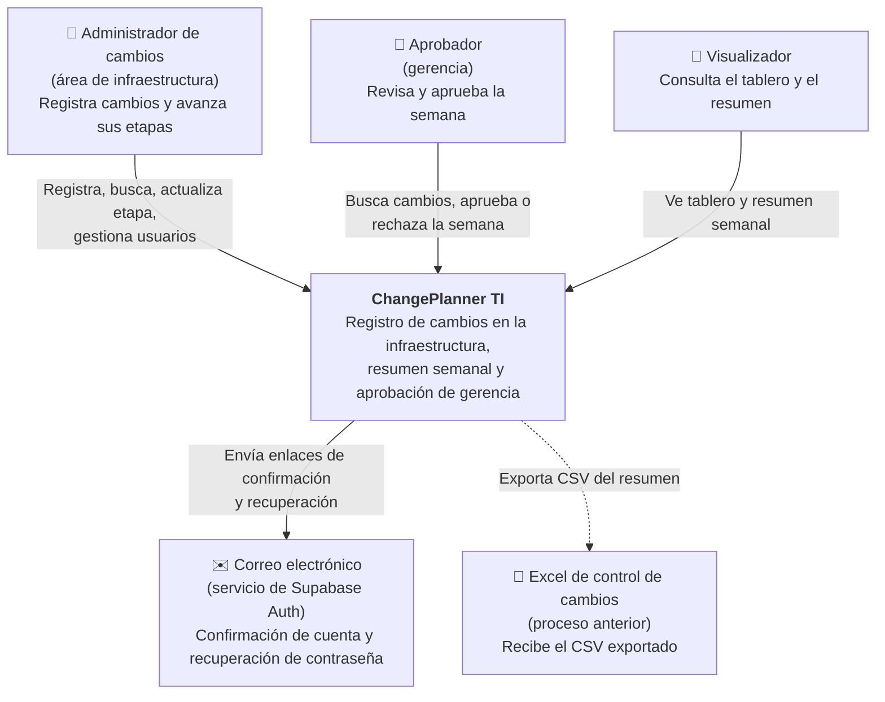
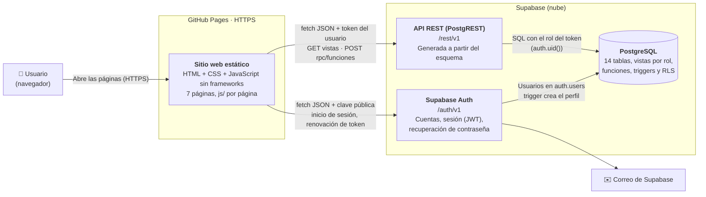
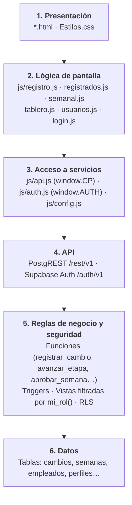
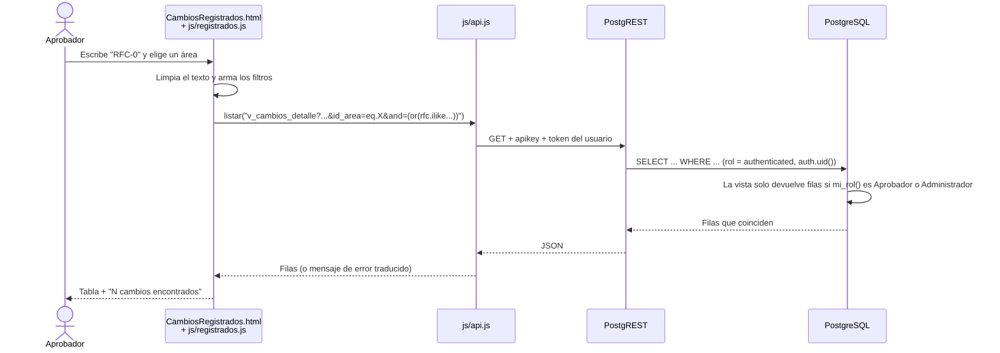

# Arquitectura · ChangePlanner TI

Cómo está construida la aplicación: quién la usa, de qué piezas se compone, qué responsabilidad tiene cada capa y dónde está cada cosa en el repositorio. Las decisiones que llevaron a esta forma están en [docs/decisiones/](decisiones/).

**App en producción:** https://cfrancklin0501.github.io/ProyectoFinal-ChangePlannerTI/

## 1. Diagrama de contexto

Quién usa el sistema y con qué sistemas externos habla.



## 2. Diagrama de contenedores

Las piezas que se despliegan y cómo se comunican. No hay servidor propio: el navegador habla directo con Supabase y la base de datos hace cumplir las reglas.



| Contenedor | Tecnología | Responsabilidad | Dónde está |
|---|---|---|---|
| Sitio web estático | HTML, CSS, JavaScript (ES2017+, `fetch`) | Pantallas, validación para ayudar al usuario, llamadas a la API | Raíz del repo, `js/`, `Estilos.css` |
| Supabase Auth | GoTrue (servicio de Supabase) | Registro, inicio de sesión, tokens JWT, recuperación de contraseña | Configuración en el panel de Supabase |
| API REST | PostgREST (servicio de Supabase) | Expone vistas y funciones como URLs; pasa el token a la base | Se genera sola desde `supabase/migrations/` |
| Base de datos | PostgreSQL (Supabase) | Datos, reglas de negocio, permisos por rol, historial | `supabase/migrations/` (esquema versionado) |
| Hosting | GitHub Pages (rama `main`, raíz) | Servir los archivos estáticos con HTTPS | Configuración del repositorio en GitHub |

## 3. Capas en el stack

La regla de oro: **la página ayuda, la base decide.** Todo lo que el navegador valida o esconde se vuelve a comprobar en PostgreSQL, porque cualquiera puede llamar a la API sin pasar por la página.



| # | Capa | Archivos | Hace | No hace |
|---|---|---|---|---|
| 1 | Presentación | `index.html`, `login.html`, `restablecer.html`, `RegistrarCambio.html`, `CambiosRegistrados.html`, `CambiosSemanal.html`, `Usuarios.html`, `Estilos.css` | Estructura accesible (etiquetas, `role`, `aria-live`), formularios con validación nativa, estilos e impresión | No contiene lógica ni datos |
| 2 | Lógica de pantalla | Un script por página en `js/` | Lee el formulario, arma la consulta, pinta la tabla con `textContent` (evita inyección de HTML), muestra mensajes | No decide permisos: solo oculta botones por comodidad |
| 3 | Acceso a servicios | `js/api.js`, `js/auth.js`, `js/config.js` | Un único punto para hablar con Supabase: agrega el token, renueva la sesión, traduce errores de la base a mensajes claros, protege páginas y arma el menú por rol | No guarda secretos: solo la URL y la clave **pública** |
| 4 | API | PostgREST y Supabase Auth (servicios) | Convierte URLs en consultas SQL con el usuario del token | No tiene código propio del proyecto |
| 5 | Reglas y seguridad | `supabase/migrations/*.sql` (funciones, triggers, vistas, políticas) | `exigir_rol()` en cada función, vistas que filtran por `mi_rol()`, orden de las etapas, aprobación solo por el Aprobador, copia antes de eliminar | — |
| 6 | Datos | `supabase/migrations/*.sql` (tablas), `supabase/seed.sql` | Llaves, restricciones `check`, únicos, historial de cambios | — |

### Ejemplo: una búsqueda en Cambios registrados (flujo de la semana 6)



## 4. Flujos completos en producción

| # | Flujo | Rol | Semana | Estado |
|---|---|---|---|---|
| 1 | Registrar un cambio y avanzarlo por etapas (Registrado → Aprobado en sesión → Ejecutado) | Administrador | 3 · etapas en 5 | En producción |
| 2 | **Buscar y filtrar cambios** (código, área, usuario, etapa, semana) — elegido de la prueba con usuarios (H2) | Aprobador, Administrador | 6 | En producción |
| 3 | Resumen semanal y aprobación de gerencia | Aprobador | 3–4 | En producción |
| 4 | Cuentas: registro, inicio de sesión, recuperación de contraseña | Todos | 4 | En producción |
| 5 | Gestión de usuarios y roles | Administrador | 4 | En producción |
| 6 | Autocompletar empleado por código (H3) | Administrador | 7 | Planeado |

## 5. Estructura de carpetas

```
ProyectoFinal-ChangePlannerTI/
├── index.html                 Inicio: tablero gerencial (todos los roles)
├── login.html                 Iniciar sesión, crear cuenta, recuperar contraseña
├── restablecer.html           Nueva contraseña (enlace del correo)
├── RegistrarCambio.html       Registrar cambio (Administrador)
├── CambiosRegistrados.html    Buscar y ver cambios; actualizar etapa, editar, eliminar (Administrador)
├── CambiosSemanal.html        Resumen semanal, aprobación, CSV e impresión
├── Usuarios.html              Usuarios y roles (Administrador)
├── Estilos.css                Estilos compartidos (incluye impresión y pantallas pequeñas)
├── js/
│   ├── config.js              URL y clave pública de Supabase
│   ├── auth.js                Sesión, protección de páginas y menú por rol (window.AUTH)
│   ├── api.js                 Cliente REST, errores, fechas y semanas (window.CP)
│   └── <página>.js            Un script por página: registro, registrados, semanal, tablero, usuarios, login
├── supabase/
│   ├── migrations/            Esquema versionado: AAAAMMDDNNNNNN_descripcion.sql (se ejecutan en orden)
│   ├── seed.sql               Datos de ejemplo para desarrollo
│   └── cuentas-demo.sql       Roles de las cuentas de demostración
└── docs/
    ├── vision.md · plan.md · mapa-historias.md · backlog-historias.md
    ├── modelo-datos.md · permisos.md · arquitectura.md
    ├── pruebas-usuarios.md · issues-semana-5.md
    ├── decisiones/            Registro de decisiones (contexto, decisión, alternativas, consecuencias)
    └── bitacora/              Una bitácora por semana
```

**Convenciones**
- Una página = un `.html` en la raíz + un script en `js/` con el mismo propósito.
- Los scripts no comparten variables globales salvo `window.CONFIG`, `window.AUTH` y `window.CP`.
- Todo cambio de base de datos es una migración nueva; nunca se edita una migración ya ejecutada.
- Las reglas que importan van en la base; si también están en la página es solo para avisar antes.

## 6. Despliegue

1. Los cambios entran a `main` por pull request.
2. GitHub Pages publica `main` (raíz) automáticamente con HTTPS.
3. Las migraciones nuevas se ejecutan en el **SQL Editor** de Supabase, en orden (ver README).
4. Cada semana se crea la etiqueta y el release `semana-N`.
