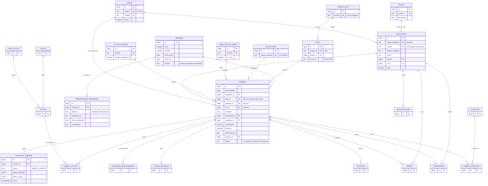

# Modelo de datos · ChangePlanner TI

Base de datos: **PostgreSQL en Supabase**. Las migraciones versionadas están en [`supabase/migrations/`](../supabase/migrations) y los datos de ejemplo en [`supabase/seed.sql`](../supabase/seed.sql).

El diagrama muestra el **producto completo (24 tablas)**. En la semana 3 se implementan las **12 tablas del núcleo** (con atributos); las otras 12 son el camino de las próximas semanas (solo identificador).

## Diagrama (producto completo)

## Mapa de la tabla de Excel a la base

| Columna del Excel | Dónde vive ahora |
|---|---|
| Fecha de ingreso | `cambios.fecha_ingreso` |
| Código Empleado, Usuario | `empleados.codigo_empleado`, `empleados.usuario` |
| Área, ID Área | `areas.nombre`, `areas.codigo` (vía `cambios.area_id`) |
| ID Solicitud | `solicitudes.codigo_solicitud` |
| RFC, RFC Local/Regional, ID-RFC-BI | `rfcs.codigo_rfc`, `ambitos_rfc.nombre`, `rfcs.id_rfc_bi` |
| Actividad, Clasificación, Resultado | `cambios.actividad`, `clasificaciones`, `resultados_cambio` |
| Confirmación, Firmadas, Observaciones | `cambios.confirmacion`, `cambios.firmadas`, `cambios.observaciones` |
| Aprobado por, Fecha de Aprobación | `aprobaciones_semanales` (se muestran en la vista `v_cambios_detalle`) |
| Estado (columna nueva) | `cambios.estado` |

## Diccionario de datos (tablas implementadas)

Notación: **PK** llave primaria, **FK** llave foránea, **UK** única, **NN** no nula. Todas las llaves primarias son `bigint generated always as identity`.

### areas
| Columna | Tipo | Llave | Restricciones |
|---|---|---|---|
| id | bigint | PK | |
| codigo | text | UK | NN, no vacío (`areas_codigo_unico`) |
| nombre | text | UK | NN, no vacío (`areas_nombre_unico`) |
| activa | boolean | | NN, por defecto `true` |
| created_at | timestamptz | | NN, por defecto `now()` |

### roles
| Columna | Tipo | Llave | Restricciones |
|---|---|---|---|
| id | bigint | PK | |
| nombre | text | UK | NN (`roles_nombre_unico`). Valores: Solicitante, Ejecutor, Aprobador |
| descripcion | text | | |

### clasificaciones
| Columna | Tipo | Llave | Restricciones |
|---|---|---|---|
| id | bigint | PK | |
| nombre | text | UK | NN. Valores: Estándar, Normal, Emergencia |
| descripcion | text | | |
| requiere_justificacion | boolean | | NN, por defecto `false`. En Emergencia es `true` |

### ambitos_rfc
| Columna | Tipo | Llave | Restricciones |
|---|---|---|---|
| id | bigint | PK | |
| nombre | text | UK | NN. Valores: Local, Regional |

### resultados_cambio
| Columna | Tipo | Llave | Restricciones |
|---|---|---|---|
| id | bigint | PK | |
| nombre | text | UK | NN. Valores: Pendiente, Exitoso, Fallido, Revertido |
| es_final | boolean | | NN, por defecto `true` (Pendiente es `false`) |

### empleados
| Columna | Tipo | Llave | Restricciones |
|---|---|---|---|
| id | bigint | PK | |
| codigo_empleado | text | UK | Opcional (varios nulos permitidos) |
| usuario | text | UK | NN, no vacío; único sin distinguir mayúsculas (`empleados_usuario_unico` sobre `lower(usuario)`) |
| nombre_completo | text | | |
| correo | text | | Formato válido si se informa (`empleados_correo_formato`) |
| area_id | bigint | FK → areas.id | NN |
| rol_id | bigint | FK → roles.id | NN |
| activo | boolean | | NN, por defecto `true` |
| created_at, updated_at | timestamptz | | NN; `updated_at` lo mantiene un trigger |

### solicitudes
| Columna | Tipo | Llave | Restricciones |
|---|---|---|---|
| id | bigint | PK | |
| codigo_solicitud | text | UK | NN, no vacío |
| created_at | timestamptz | | NN |

### rfcs
| Columna | Tipo | Llave | Restricciones |
|---|---|---|---|
| id | bigint | PK | |
| codigo_rfc | text | UK | NN, no vacío |
| ambito_id | bigint | FK → ambitos_rfc.id | NN |
| id_rfc_bi | text | | |
| created_at | timestamptz | | NN |

### semanas
| Columna | Tipo | Llave | Restricciones |
|---|---|---|---|
| id | bigint | PK | |
| anio, semana | smallint | UK (anio, semana) | NN; `semana` entre 1 y 53; semana ISO (lunes a domingo) |
| fecha_inicio, fecha_fin | date | | NN; `fecha_fin = fecha_inicio + 6` |
| estado | text | | NN, por defecto `Abierta`; solo `Abierta`, `Aprobada` o `Rechazada` |
| created_at | timestamptz | | NN |

Se crea sola la primera vez que se registra un cambio de esa semana (`obtener_o_crear_semana`).

### cambios
| Columna | Tipo | Llave | Restricciones |
|---|---|---|---|
| id | bigint | PK | |
| fecha_ingreso | date | | NN; no puede ser futura (trigger) |
| empleado_id | bigint | FK → empleados.id | NN |
| area_id | bigint | FK → areas.id | NN. Guarda el área en el momento del cambio, aunque el empleado cambie de área después |
| solicitud_id | bigint | FK → solicitudes.id | Opcional |
| rfc_id | bigint | FK → rfcs.id | Opcional |
| actividad | text | | NN; mínimo 10 caracteres (`cambios_actividad_longitud`) |
| clasificacion_id | bigint | FK → clasificaciones.id | NN |
| resultado_id | bigint | FK → resultados_cambio.id | NN |
| confirmacion, firmadas | boolean | | NN, por defecto `false` |
| observaciones | text | | Obligatoria (mínimo 10 caracteres) si la clasificación requiere justificación |
| semana_id | bigint | FK → semanas.id | NN; la asigna un trigger a partir de `fecha_ingreso` |
| estado | text | | NN, por defecto `Por aprobar`; solo `Por aprobar`, `Aprobado` o `Rechazado` |
| created_at, updated_at | timestamptz | | NN |

### aprobaciones_semanales
| Columna | Tipo | Llave | Restricciones |
|---|---|---|---|
| id | bigint | PK | |
| semana_id | bigint | FK → semanas.id | NN |
| decision | text | | NN; solo `Aprobada` o `Rechazada` |
| aprobado_por | text | | NN; mínimo 3 caracteres |
| fecha_aprobacion | date | | NN; no puede ser futura (la valida la función) |
| comentarios | text | | Obligatorio (mínimo 5 caracteres) si la decisión es `Rechazada` (`aprobaciones_rechazo_con_comentario`) |
| created_at | timestamptz | | NN |

Una semana rechazada puede decidirse otra vez, por eso una semana puede tener varias filas; la vigente es la más reciente.

### historial_cambios
| Columna | Tipo | Llave | Restricciones |
|---|---|---|---|
| id | bigint | PK | |
| cambio_id | bigint | FK → cambios.id | NN |
| accion | text | | NN; `INSERT` o `UPDATE` |
| datos_anteriores | jsonb | | Solo en `UPDATE` |
| datos_nuevos | jsonb | | NN |
| ejecutado_por | text | | NN, por defecto el rol de base de datos que ejecutó el cambio |
| fecha | timestamptz | | NN |

Lo llena un trigger; la aplicación nunca escribe aquí.

## Qué pasa al borrar

| Si se borra… | …y existen | Comportamiento | Motivo |
|---|---|---|---|
| un área | empleados o cambios | **RESTRICT** (se bloquea) | Se desactiva (`activa = false`), no se borra |
| un rol | empleados | **RESTRICT** | Catálogo estable |
| una clasificación, resultado o ámbito | cambios o RFC | **RESTRICT** | Catálogos usados por el histórico |
| un empleado | cambios | **RESTRICT** | Se conserva quién hizo el cambio; se desactiva (`activo = false`) |
| una solicitud | cambios | **SET NULL** | El cambio sigue existiendo aunque se retire el ticket |
| un RFC | cambios | **SET NULL** | Igual que la solicitud |
| una semana | cambios | **RESTRICT** | Una semana con cambios no se puede borrar |
| una semana (sin cambios) | aprobaciones | **CASCADE** | Las decisiones no tienen sentido sin su semana |
| un cambio | historial | **CASCADE** | El borrado físico de un cambio es excepcional (solo administrador por SQL); la app nunca borra |

## Reglas de negocio que impone la base de datos

1. Actividad de al menos 10 caracteres.
2. La fecha de ingreso no puede ser futura.
3. Un cambio de **Emergencia** exige justificación en Observaciones (mínimo 10 caracteres).
4. Si se informa un RFC, hay que indicar si es Local o Regional.
5. Un usuario existe una sola vez (sin distinguir mayúsculas) y un código de empleado pertenece a un solo usuario.
6. Una **semana aprobada** queda cerrada: no admite cambios nuevos y sus cambios no se pueden modificar.
7. **Rechazar** una semana exige un comentario (mínimo 5 caracteres).
8. No se puede aprobar una semana sin cambios, ni una que ya fue aprobada.
9. Toda creación o modificación de un cambio queda en `historial_cambios`.

La aplicación muestra estos mensajes tal cual los devuelve la base (ver `js/api.js`).

## Acceso y seguridad

Todas las tablas tienen **RLS activado**. La web usa la clave pública (rol `anon`) y solo puede:

- **Leer** los catálogos y las vistas `v_cambios_detalle`, `v_resumen_semana` y `v_cambios_por_usuario` (no exponen el correo de los empleados).
- **Escribir** únicamente llamando a las funciones `registrar_cambio` y `aprobar_semana`. No hay `INSERT`, `UPDATE` ni `DELETE` directos.

**Limitación conocida:** todavía no hay inicio de sesión, así que cualquiera que conozca la URL puede ejecutar esas dos funciones. Se corregirá con Supabase Auth; mientras tanto no se deben cargar datos reales sensibles.
